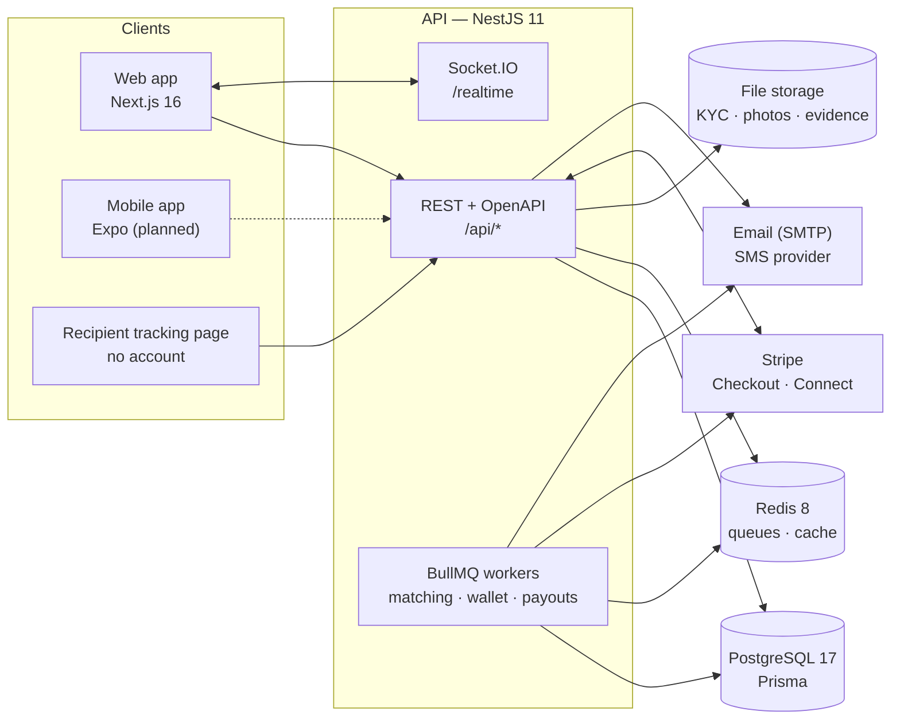
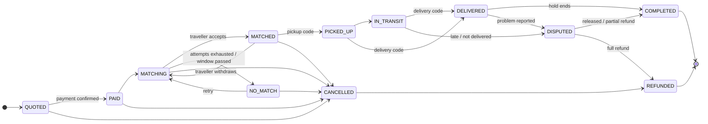
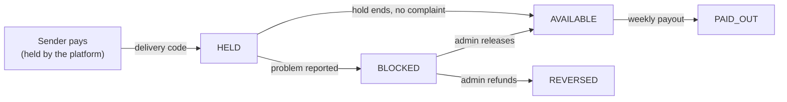

# Architecture

Mersal is a TypeScript monorepo with one API, one web app and two shared packages. The
API owns every business rule. The web app (and later the mobile app) only calls it.

## Repository

| Path              | Contents                                                                                                         |
| ----------------- | ---------------------------------------------------------------------------------------------------------------- |
| `apps/api`        | NestJS modules in `src/<domain>`, Prisma schema and migrations in `prisma/`, scripts                             |
| `apps/web`        | Next.js App Router in `src/app/[locale]`, translations in `messages/{en,fr,ar}.json`, e2e                        |
| `packages/shared` | zod schemas, enums, the shipment state machine and the pure pricing, matching, reliability and masking functions |
| `packages/brand`  | Logo files, colour tokens (`tokens.css`) and white-label themes                                                  |

`packages/shared` is the contract between the API and its clients. The same `calculateQuote`
runs in the API, in the admin pricing simulator and in the unit tests, so a price can never
differ between them. The mobile app will import the same schemas.

## API modules

| Module                                           | Responsibility                                                                            |
| ------------------------------------------------ | ----------------------------------------------------------------------------------------- |
| `auth`                                           | Registration, login, email and phone codes, password reset, JWT + rotating refresh tokens |
| `users`, `verification`                          | Profiles, identity documents and the admin review queue                                   |
| `catalog`, `pricing`                             | Corridors, cities, categories, restricted items; versioned tariffs, quotes, simulator     |
| `shipments`                                      | Shipment creation, the state machine, sender and admin views                              |
| `trips`, `matching`                              | Traveller trips, the matching engine, offers, withdrawals, admin overrides                |
| `payments`, `wallet`                             | Payment providers, webhooks, refunds, the ledger, holds, weekly payouts                   |
| `delivery`                                       | Pickup and delivery codes, recipient tracking links                                       |
| `messaging`, `realtime`, `notifications`, `mail` | Shipment chat with contact masking, Socket.IO, in-app notifications, email and SMS        |
| `disputes`, `reviews`, `reliability`             | Problem reports, admin resolution, two-way ratings, the reliability score                 |
| `admin`, `settings`, `audit`                     | Users, analytics, CSV reports, platform settings, audit log                               |

Every request passes through three global guards in this order: rate limiting, authentication
(Bearer token or httpOnly cookie) and roles. Routes opt out of authentication with `@Public()`.
Errors always have the shape `{ code, message }`. Clients translate `code`, so the API never
returns user-facing text.

## Shipment lifecycle

The allowed transitions are a table in `packages/shared/src/enums.ts`. `ShipmentStateService`
applies them with an optimistic update (`WHERE status = <expected>`) and writes a
`ShipmentEvent` with the actor in the same transaction. A concurrent change therefore fails
instead of overwriting another one. Operations that touch money or matching for a shipment
also take a Postgres advisory lock on its id.

## Money

All amounts are integers in the currency's minor unit. Balances are never stored. They are
sums over an append-only ledger where every movement is a pair of entries sharing a
`transactionId`.

- **Payment before matching.** Matching starts only when the provider confirms the payment.
  This is a webhook for Stripe, or the demo provider's confirmation locally. Webhooks are
  stored in `WebhookEvent` and processed at most once.
- **Hold.** Confirming delivery records the traveller's earning as `HELD`, with a release time
  (48 hours by default, editable in settings). A job moves due holds to `AVAILABLE` and
  completes the shipment.
- **Payouts.** A weekly job (the weekday is a setting) groups each traveller's available
  balance into one transfer. With Stripe this is a transfer to a Connect Express account,
  using separate charges and transfers. A failed payout returns the money to `AVAILABLE` and
  can be retried from the admin.
- **Refunds and disputes.** Cancelling before pickup refunds the sender in full. A dispute
  blocks the earning. The admin then releases it, refunds part of it, or refunds all of it.
  A chargeback webhook opens a dispute automatically.

`PaymentProvider` is an interface with two implementations. `StripePaymentProvider` is used
when `STRIPE_SECRET_KEY` is set. `DemoPaymentProvider` is used otherwise, for local work and
demos without a Stripe account.

## Pricing

Each corridor has versioned tariffs. Only one version is active at a time, and every quote
stores the version it was priced with. The calculation order is:

1. **Chargeable weight**: the greater of the real weight and the volumetric weight (L × W × H ÷ divisor).
2. **Base price**: from the matching weight bracket.
3. **Adjustments**: the category multiplier, then the urgency multiplier.
4. **Declared value**: a percentage fee above the free cover threshold.
5. **Options**: paid options such as extra cover, photo proof or fragile handling.
6. **Minimum and rounding**: the minimum price is applied, then rounding.
7. **Split**: the total is divided into the platform commission and the traveller's share.

Admins edit a draft version and test it in the simulator before activating it. Quotes expire
after a configurable time.

## Matching

Matching runs when a payment is confirmed, when a trip is published, when an offer is
declined or expires, and on a periodic tick.

1. **Hard exclusions**, each logged with its reason:
   - the traveller is the sender, suspended or not verified, or below the minimum reliability;
   - they were already offered this parcel;
   - the destination differs, the departure is outside the date window, or the trip lacks
     space, item slots or allowed size;
   - the category is not accepted.
2. **Weighted score**: reliability, date proximity (counted twice for express parcels),
   capacity fit, rating, response rate and origin match. Admins set the weights per corridor.
3. **One offer at a time**, with an expiry. A decline or an expiry moves on to the next
   candidate. After the maximum number of attempts, or once the delivery window has passed,
   the parcel becomes `NO_MATCH` and the sender is told.

Every run is stored as a `MatchRun` with the configuration snapshot and every candidate's
score or exclusion reason. The admin can see why a traveller was or wasn't chosen, and can
propose a parcel to a specific trip.

## Background jobs

| Queue      | Job              | Schedule                    | Work                                                   |
| ---------- | ---------------- | --------------------------- | ------------------------------------------------------ |
| `matching` | `matching.run`   | on events                   | One matching run for a shipment                        |
| `matching` | `matching.tick`  | every minute (15 s in demo) | Expire offers, close passed windows, finish past trips |
| `wallet`   | `wallet.tick`    | every 5 min (15 s in demo)  | Release holds that have reached their time             |
| `wallet`   | `payouts.weekly` | cron, weekday from settings | Weekly payouts                                         |

With `DEMO_MODE=true` the hold lasts minutes instead of hours and offers expire after a few
minutes, so the full flow can be shown in one sitting. Email and phone codes are also
returned to the client, which avoids needing a mailbox or SIM during a demo.

## Realtime and notifications

Socket.IO on the `/realtime` namespace authenticates with the same session cookie or token
and checks the origin. Each user joins `user:<id>`, and the participants of a shipment join
`shipment:<id>`. Notifications are stored in the database, pushed over the socket and, for
important events, sent by email. SMS goes through an interface that logs locally; production
needs a provider such as Twilio.

## Security and privacy

- **Passwords and sessions.** Passwords use scrypt. Access tokens last 15 minutes. Refresh
  tokens are opaque, stored hashed, rotated on every use and revoked on logout. Cookies are
  httpOnly and SameSite=Lax.
- **Role checks.** Every admin route requires the `ADMIN` role, and every shipment route
  checks that the caller is a party to the shipment.
- **Files.** Identity documents and dispute evidence are served only to their owner and to
  admins, based on the storage key prefix.
- **Chat masking.** Phone numbers and email addresses in chat are masked for the other party.
  Admins see the original text.
- **Rate limiting.** Limits are stricter on authentication routes.
- **Audit log.** Sensitive actions (approvals, refunds, setting and tariff changes, dispute
  decisions) write an `AuditLog` row with actor, before/after values and IP. Secrets and
  codes are redacted.
- **GDPR.** Data is minimised per role, and the privacy policy draft lists purposes,
  retention and rights. Export and erasure endpoints are on the roadmap.

## Internationalisation and white-label

The UI ships in English, French and Arabic, with full right-to-left layout for Arabic.
Reference data (cities, categories, options, restricted items) stores its names in all three
languages, and emails are sent in the recipient's language. The brand lives in
`packages/brand`: colours are CSS variables selected by `data-brand` on `<html>`, so a partner
theme can be added without touching components (see `/brand`).

## Testing

| Level                    | Tool                                  | Covers                                                                                                           |
| ------------------------ | ------------------------------------- | ---------------------------------------------------------------------------------------------------------------- |
| Unit (`packages/shared`) | Node test runner                      | Pricing, matching, reliability, masking, references, the state machine                                           |
| Unit (`apps/api`)        | Node test runner                      | Password hashing, wallet rules                                                                                   |
| End-to-end               | Playwright, against the running stack | Onboarding, quoting and tariff changes, matching, the full lifecycle (pay → payout), disputes and admin insights |

## From local to production

| Concern  | Local               | Production                                                            |
| -------- | ------------------- | --------------------------------------------------------------------- |
| Payments | Demo provider       | Stripe live keys, webhooks, Connect onboarding                        |
| Files    | Local disk          | S3-compatible storage, through the same storage interface             |
| Email    | Mailpit             | Transactional email provider (SMTP)                                   |
| SMS      | Logged              | SMS provider behind `SmsService`                                      |
| Identity | Manual review queue | Optionally Stripe Identity or Sumsub before the manual review         |
| Hosting  | Docker Compose      | Managed Postgres and Redis; API and web in containers on an EU region |
